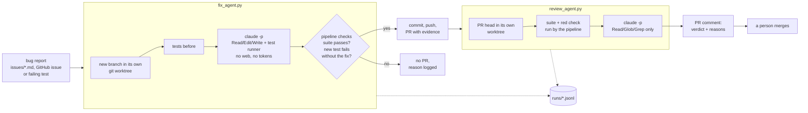

# agent-fix-pipeline

Two headless Claude Code agents that turn a rough bug report into a reviewed pull request:

- the **fix agent** reproduces the bug with a failing test, fixes it, and opens a PR with before/after evidence;
- the **review agent**, a separate read-only session, checks that the new test really catches the bug and comments on the PR.

The code they work on is a deliberately small sample app (`ledger/`, an invoicing library with three planted bugs, reported
in `issues/`). The point of the repository is the pipeline around the agents: sandboxing, limited permissions, mechanical
checks that do not trust the agent's own word, and a log line for every step.

## Architecture



| Step | Who does it | Why |
|---|---|---|
| Create branch and worktree | pipeline | the agent never touches the main checkout |
| Reproduce, then fix | fix agent (`claude -p`) | the test is written before the fix and must fail first |
| Suite passes, red check | pipeline | the agent's claims are checked by code: the new test must FAIL when the fix is reverted |
| Commit, push, open PR | pipeline | the agent has no git write access and no GitHub token |
| Review | review agent, a separate `claude -p` | the author does not grade its own work; the reviewer can only read |
| Merge | a person | nothing merges automatically |

### The red check

A test that passes with and without the fix proves nothing. Both agents' pipelines therefore take the change's non-test
files back to the base version, run only the changed test files and require them to **fail**, then restore the fix.
The fix agent opens no PR when this fails. The review agent reports it in its comment.

## Security model

- **Sandbox:** each run gets a fresh git worktree under `.worktrees/` on its own branch. The agent's working directory
  is that worktree; the main checkout is untouched.
- **Least privilege, by tool list:**
  - Fix agent: `Read, Edit, Write, Glob, Grep`, and `Bash` only for `python -m unittest`, `python -m pytest`, `git diff`
    and `git status`.
  - Explicitly denied: web fetch/search, `git commit`, `git push`, `gh`, `curl`.
  - `--permission-mode dontAsk` turns anything else into a refusal instead of a prompt.
  - Review agent: `Read, Glob, Grep` only; no shell at all.
- **No secrets in the agent:**
  - The agent's environment is stripped of every `*TOKEN`, `*SECRET`, `*_KEY`, `*PASSWORD` variable (except
    `ANTHROPIC_API_KEY`, which Claude Code itself needs in CI).
  - No MCP servers are loaded (`--strict-mcp-config`), and no user-level settings or hooks (`--setting-sources project`).
  - In CI, `--bare` also skips plugins and CLAUDE.md discovery.
- **No production data:** the agents see the repository and nothing else.
- **A person approves:** the pipeline opens PRs; it never merges them.
- **Logged:** every step is a line in `runs/<run_id>.jsonl` (see below). Machine paths are scrubbed from logs, PR bodies
  and comments.

## Runbook

Requirements:
- Python 3.10+.
- Claude Code (`claude`), logged in or with `ANTHROPIC_API_KEY` set.
- git.
- `gh` logged in, to open PRs and post comments.

```bash
# the sample app's tests (standard-library unittest; pytest runs them too)
python -m unittest discover -s tests -t . -v

# fix one report: worktree, agent, checks, PR
python pipeline/fix_agent.py --issue issues/001-split-loses-a-cent.md
python pipeline/fix_agent.py --github-issue 12        # a GitHub issue instead of a file
python pipeline/fix_agent.py --failing-test tests/test_split.py
python pipeline/fix_agent.py --issue issues/002-price-off-by-one-cent.md --no-pr   # stop after the checks

# review a PR (separate session, read-only)
python pipeline/review_agent.py --pr 1
```

**Options:**
- `--keep` keeps the worktree for inspection.
- `--model` picks a model.
- `PIPELINE_TEST_CMD` swaps the test runner, e.g. `python -m pytest -q`.

**Without gh:** if `gh` is missing or not logged in, the scripts still push the branch. They write the PR body or the
review comment, together with the exact `gh` command, into `runs/<run_id>/` for a person to run.

**Exit codes:**
- `fix_agent.py` returns 0 when a PR was opened or prepared, and 1 when the checks failed (no PR).
- `review_agent.py` returns 0 when the review produced a verdict.

### Run log format

`runs/<run_id>.jsonl`, one JSON object per line: `time`, `run_id`, `event`, `elapsed_s`, plus per-event fields:

| Event | Fields |
|---|---|
| `start` | trigger, base commit, branch, allowed and denied tools |
| `tests_before` | passed, exit code, tests run, seconds |
| `agent` | exit code, seconds, turns, cost estimate |
| `checks` | changed files, diff stat, tests after, red check |
| `commit`, `push`, `pr` / `comment` | — |
| `end` | outcome, exit code |

Full test outputs, the agent's summary and the PR body sit next to it in `runs/<run_id>/`.

### CI (example, not run)

`.github/workflows/agent-fix.yml` runs the same scripts on GitHub Actions:
- **When an issue is labelled `agent-fix`:** the fix agent works on that issue, then the review agent comments on its PR.
- **Nightly (or by hand), when the suite is red:** the fix agent works on the failing tests.

It assumes a repository secret `ANTHROPIC_API_KEY` and uses the job's `GITHUB_TOKEN`. **This repository does not include
an API key and the workflow has not been run here.** Add the secret to try it.

## Evidence

A real run on this repository, 2026-11-01 (logs committed under `runs/`):

| Step | Result | Log |
|---|---|---|
| Fix agent on `issues/001-split-loses-a-cent.md` | test written first, fix in `ledger/split.py`; suite 11 → 12 tests, all pass; red check: the new test FAILS with the fix taken out (999 != 1000); [PR #1](https://github.com/kuzgunay/agent-fix-pipeline/pull/1) opened by the pipeline. 7 turns, 36 s. | `runs/20261101T105817Z-fix-split-bill-loses-a-cent.jsonl` |
| Review agent on PR #1 | separate read-only session; re-ran the suite and the red check itself; [verdict APPROVE](https://github.com/kuzgunay/agent-fix-pipeline/pull/1#issuecomment-6557029755). 2 turns, 12.5 s. | `runs/20261101T105909Z-review-agent-fix-split-bill-loses-a-cent-202611.jsonl` |
| An earlier attempt | the agent could not authenticate; the pipeline opened no PR and logged why. Kept as an example of the failure path. | `runs/20261101T103618Z-fix-split-bill-loses-a-cent.jsonl` |

PR #1 stays open on purpose: merging is a person's step. Issues 002 and 003 are left for you to try.

## Limits

- **The sample app is tiny on purpose.** On a real codebase you would add: a time and cost budget per run, a cap on
  diff size, a denylist of paths the agent may not edit, and a dependency cache inside the sandbox.
- **The red check reverts whole files.** A PR whose test file also changes helper code would need a finer revert.
- **"The suite passes" is only as good as the suite.** The review agent reads the code for edge cases, but it is
  advisory: a person merges.
- **The worktree is a soft sandbox.** It is a git-level boundary plus a tool allowlist, not a container. For untrusted
  code, run the whole pipeline inside a container or VM with no network except the model API.
- **The agents are non-deterministic.** Two runs on the same report can produce different (both valid, or one invalid)
  fixes; the checks decide.

## License

MIT
